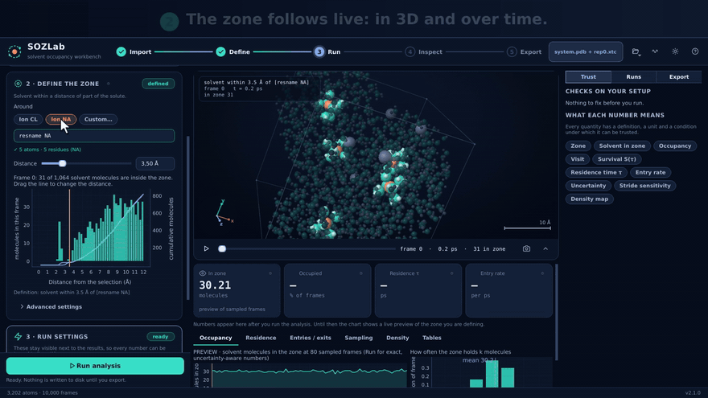

<h1 align="center">SOZLab</h1>

<p align="center"><b>See the solvent around your molecule, and know how far to trust what you see.</b></p>

<p align="center">
  <a href="LICENSE"></a>
  
  
  
</p>

<p align="center">
  <a href="docs/media/sozlab-demo.mp4?raw=true"></a><br>
  <sub>Real data (TIP3P water + NaCl simulated with OpenMM), the real engine, nothing mocked.
  <a href="docs/media/sozlab-demo.mp4?raw=true"><b>▶ Watch the one-minute tour</b></a></sub>
</p>

**SOZLab asks the questions you ask of a hydration shell and says how sure it is of each answer.**
How many waters sit within 3.2 Å of this ion? How long does each one stay? How often do they swap? Where is the water enriched
around my protein? And: *would the answer change if I had saved frames less often?*

- **Define a zone by dragging one line.** Pick a part of your molecule, drag the distance on the histogram, and watch the zone follow in
  3D and in an occupancy-over-time preview before you run anything.
- **Numbers you can defend.** Every result carries its unit, a standard error and a trust badge. Caveats are written in plain
  language: *"the residence time changes by +32 % with 2× coarser sampling: quote it with its interval."*
- **Provenance built in.** Input hashes, the configuration hash and a manifest travel with every export. Frame extraction refuses a
  trajectory that changed since the analysis. The GUI and the CLI give identical results, down to the per-frame solvent identities.

## Try it in two minutes

```bash
pip install -e .
sozlab-gui --demo                    # a built-in synthetic hydrated solute: no data needed
sozlab-gui system.gro run.xtc        # your own topology + trajectory (GROMACS, AMBER, CHARMM, NAMD, …: anything MDAnalysis reads)
sozlab-cli selftest                  # known-answer checks on your installation (about 10 s)
```

The Workbench is five steps on one screen: **Import**, **Define**, **Run**, **Inspect**, **Export**. [The user guide](docs/user_guide.md) walks
through every control; you do not need it to get a first result.

## What you get

| | what it measures | what comes with it |
|---|---|---|
| **Occupancy** | molecules in the zone, per frame and on average | standard error that accounts for correlation between frames |
| **Entries and exits** | solvent crossing the zone boundary between frames | the rate *and* how it depends on the frame interval |
| **Residence** | how long a molecule stays: survival function S(τ), Kaplan–Meier, mean visit, optional brief-exit tolerance | visits cut by the window are flagged; block errors; sensitivity to the stride, measured |
| **Density** | time-averaged solvent density in the frame of the solute (made whole, wrapped, superposed every frame) | measured bulk reference, g(r) and −ln g, reliability mask, content-keyed cache |
| **Extraction** | frames where a rule holds (e.g. "≥ 2 molecules for ≥ 5 frames") written to a new trajectory | inputs and every frame verified by fingerprint before writing |
| **Provenance** | SHA-256 of inputs, configuration hash, software and algorithm versions | `manifest.json`, re-checked by `sozlab-cli verify` |

## Validated, not just claimed

Every figure below is measured by a script in [`bench/`](bench/README.md); the full table, with limits, is in [docs/evidence](docs/evidence/README.md).

- **Same zone as MDAnalysis**: 0 differences in 35 807 molecule-frame memberships on a public triclinic protein system (3, 4 and 6 Å).
- **Same physics as g(r)**: coordination numbers from the density map agree with an RDF integral to 0.04 %; the measured bulk density matches N/V to 0.06 %.
- **Survival function identical** to a brute-force implementation of its definition, and within 3×10⁻⁴ of the `waterdynamics` package.
- **13 defects of v2.0.0 reproduced on the released code and fixed**, including a stale density cache, extraction from a replaced trajectory and an assumed time step.
- **Honest about what it cannot do**: on TIP3P water around Na⁺ the continuous residence time rises from 12 ps to 23 ps as the sampling interval grows from
  0.02 to 1.28 ps. SOZLab measures that dependence for you instead of hiding it; its experimental extrapolation to zero interval is labelled *indicative only*
  because it failed on real data.

<details>
<summary><b>What is new in 2.1</b></summary>

- A new **Workbench GUI**: live 3D view of the zone, live occupancy preview, trust badges and caveats, definitions one click away, run history with overlay comparison, light and dark themes.
- **Correct time**: durations from the trajectory's time stamps (midpoint rule, irregular sampling handled); a single frame has no duration instead of an invented one.
- **Residence done properly**: censoring, survival function, Kaplan–Meier, brief-exit tolerance defined in time, stride sensitivity.
- **Uncertainty everywhere**: autocorrelation-aware and block standard errors for occupancy, residence and rates.
- **Density maps in the solute frame** with a measured bulk reference and reliability masks.
- **Verified extraction and provenance**; **parallel frame evaluation** that is bitwise identical to serial.

The full list, including the deliberate changes of meaning, is in [CHANGELOG.md](CHANGELOG.md).
</details>

## Use it

### Workbench

1. **Import**: drop a topology and trajectory on the window. The card shows atoms, frames, box, time step and the solvent SOZLab found.
2. **Define**: click a detected part (protein, ligand, ion…) or type any MDAnalysis selection, then drag the line on the distance histogram.
3. **Run**: settings stay visible beside the results; *Advanced* holds the rest, marks what you changed and resets it.
4. **Inspect**: value ± SE with a trust badge on every tile; **?** opens the definition; the *Trust* panel lists caveats.
5. **Export**: data, a report, and frames, each with a manifest; *Verify files* re-hashes them.

### Command line

```bash
sozlab-cli run --project project.json --output results/ --report
sozlab-cli validate --project project.json
sozlab-cli extract --from-results results/ --rule "n_solvent>=1" --out frames/
sozlab-cli verify results/
```

A project saved from the Workbench runs unchanged with the CLI; projects from v2.0 still open. No data at hand?
`python examples/make_demo_data.py` writes a small synthetic system and `examples/demo_project.json`.

## Install

```bash
pip install -e .            # the Workbench, the CLI and the engine
pip install -e ".[test]"    # + pytest, pytest-qt
pip install -e ".[parquet]" # optional Parquet tables
```

Python 3.10+. Developed and tested on Windows 11 with Python 3.12; the engine and CLI have no platform-specific code (Linux and macOS were not run
for this release). A conda environment is provided in `environment.yml`. The 3D view is a software renderer: no OpenGL, no GPU, no browser engine.

## Documentation

| | |
|---|---|
| [docs/user_guide.md](docs/user_guide.md) | the Workbench and CLI step by step |
| [docs/science/definitions.md](docs/science/definitions.md) | what every quantity measures, its unit, and when to trust it |
| [docs/evidence/README.md](docs/evidence/README.md) | validation, comparison with other tools, usability checks, limits |
| [docs/developer_guide.md](docs/developer_guide.md) | architecture, tests, benchmarks, how to reproduce the evidence and this video |
| [docs/design_notes.md](docs/design_notes.md) | the Workbench design system |

## Citation

If you use SOZLab in academic work, please cite (see also `CITATION.cff`):

**Ferreira Francisco, A.** *SOZLab: GUI and CLI for solvent occupancy zone analysis of molecular dynamics trajectories.*
Version 2.1.0. https://github.com/aleff-ferreira/SOZLab

## License

MIT License. Copyright (c) 2025 SOZLab contributors. See `LICENSE`.
